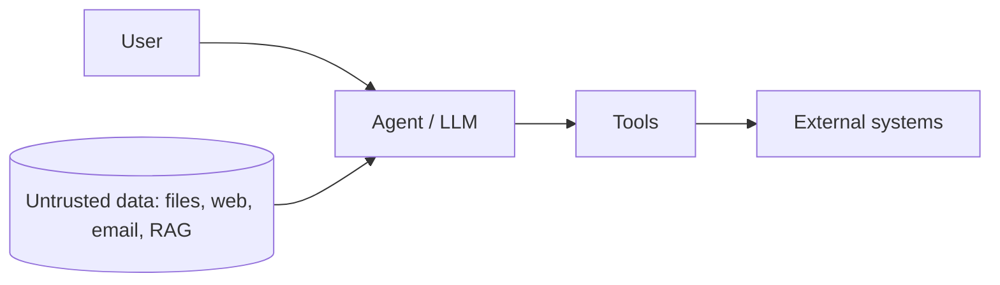

# 2. Understand: system model and threats

*Why:* you can only test what you have mapped. Untrusted input and powerful tools are where risk lives.

## 2.1 System diagram

Adjust the diagram to the real system. Mark trust boundaries.

## 2.2 Tool risk table

| Tool | What it does | Private data | Untrusted content | External communication | No human check |
|---|---|:---:|:---:|:---:|:---:|
| <tool> | <...> | Y/N | Y/N | Y/N | Y/N |

All four = highest risk (lethal trifecta, extended).

## 2.3 Threat selection (OWASP AI Exchange taxonomy)

Mark Y for threats that apply to this system. Test only those.

| Threat | AI Exchange | Applies? | Where | LLM / ASI |
|---|---|:---:|---|---|
| Evasion | 2.1 | | | |
| Direct prompt injection | 2.2.1 | | | LLM01 |
| Indirect prompt injection | 2.2.2 | | | LLM01, ASI01 |
| Agent message structure manipulation | 2.2.3 | | | ASI07 |
| Sensitive data disclosure in model output | 2.3.1 | | | LLM02 |
| Model inversion / membership inference | 2.3.2 | | | LLM02 |
| Model exfiltration | 2.4 | | | |
| AI resource exhaustion | 2.5 | | | LLM06 |
| Data / model poisoning (development-time) | 3.1 | | | LLM05 |
| Supply-chain model poisoning | 3.1.3 | | | LLM04, ASI04 |
| Sensitive data leak development-time | 3.2 | | | |
| Output contains conventional injection | 4.4 | | | LLM10 |
| Input data leak | 4.5 | | | |
| Augmentation data leak / manipulation (RAG, system prompt) | 4.6, 4.7 | | | LLM08, LLM09, ASI06 |
| Agent escape | 4.8 | | | ASI05 |
